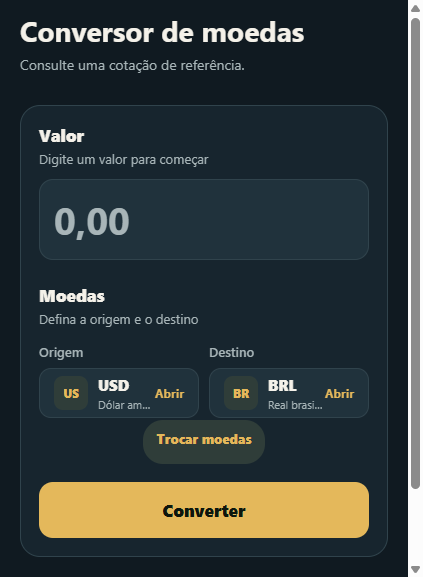
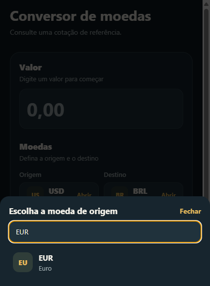
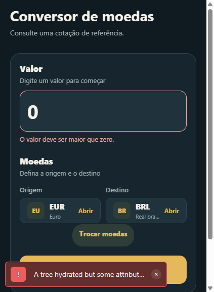

# Conversor de Moedas

Aplicativo mobile de conversão de moedas desenvolvido com React Native, Expo
SDK 58 e arquitetura MVVM. As moedas e taxas são carregadas da
[API pública Frankfurter](https://api.frankfurter.dev/).

## Requisitos

- Node.js compatível com Expo SDK 58
- Android Studio/emulador, dispositivo físico ou navegador
- npm

## Instalação e execução

```bash
npm install
npx expo start
```

No terminal do Expo, use `a` para Android, `i` para iOS ou `w` para web.
Também é possível executar diretamente:

```bash
npm run android
npm run ios
npm run web
```

## Como usar

1. Aguarde o carregamento da lista de moedas.
2. Informe um valor positivo, usando ponto ou vírgula nos centavos.
3. Escolha as moedas de origem e destino.
4. Pressione **Converter**.
5. Confira o valor convertido, a taxa usada e a data de referência.

A conversão usa a taxa retornada pela API no momento da consulta. A taxa é de
referência e não representa necessariamente uma cotação comercial em tempo real.

## Arquitetura

```text
src/
├── app/                    # Rotas do Expo Router
├── models/                 # Comunicação e validação da resposta da API
├── viewmodels/             # Estado, validações e coordenação do fluxo
├── views/                  # Tela e componentes visuais do conversor
├── utils/                  # Formatação para apresentação
└── components/             # Componentes compartilhados
```

- **Model:** [modelo-moedas.ts](src/models/modelo-moedas.ts) consulta moedas
  e taxas, tratando rede, HTTP e respostas inválidas.
- **ViewModel:** [use-conversor-moedas.ts](src/viewmodels/use-conversor-moedas.ts)
  controla estados, validações, carregamento e cálculo.
- **View:** [TelaConversor.tsx](src/views/TelaConversor.tsx) apresenta os
  campos, seletores, mensagens e resultado.

## Validações e tratamento de erros

O aplicativo bloqueia valores vazios, inválidos, zero, negativos e moedas
iguais. Também impede consultas simultâneas, mostra carregamento, limpa
resultados antigos ao alterar os campos e permite tentar novamente quando a API
falha.

## Capturas de tela

### Tela inicial



### Seleção de moeda



### Resultado da conversão


### Validação de valor



## Verificações de código

```bash
npx tsc --noEmit
npx expo lint
```

O lint pode solicitar a instalação/configuração do ESLint na primeira execução.
